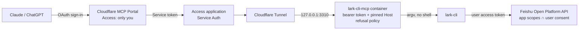

# Architecture and design

[中文](architecture.zh-CN.md)

Why lark-cli-mcp is built the way it is, how a call flows, and the four permission layers with where each one is controlled. For setup see the [README](../README.md) and [cloudflare-mcp-portal.md](cloudflare-mcp-portal.md).

## 1. The problem

- Let AI assistants such as Claude and ChatGPT create docs, fill Base tables and organize Wiki pages in Feishu/Lark.
- Clients connect to one MCP entry point with several servers behind it, so adding a service later doesn't mean reconfiguring every client.
- An assistant can be misled by text it reads (prompt injection), so it must **never get a shell on the server**, and what it can do needs clear limits.

## 2. Options considered

| Option | Problem |
| --- | --- |
| Official `lark-openapi-mcp` | Largely unmaintained since 2025 (v0.5.1, still Beta); one tool per API, many tools, awkward for writing docs. |
| Feishu's hosted remote MCP | In closed beta at the time of writing, docs only; short-lived credentials don't suit a long-running gateway. |
| A server account for the AI that runs `lark-cli` | The AI gets a shell and with it the whole server. |
| A generic "run a command" MCP | Either close to a shell, or it rejects `|`, `<`, `>` for safety and Markdown tables and headings can't get through. |
| **This project: wrap only `lark-cli`** | Feishu's official CLI has the widest and freshest coverage; a thin MCP layer adds no shell, only refusal rules. |

## 3. Overview



- No port is open to the internet: the container listens on loopback and `cloudflared` dials out.
- Clients know only the Portal URL; the Portal reaches the origin with a service token, and the origin's Access app accepts only that token.
- Any other reverse proxy works as long as it keeps both gates: the proxy authenticates, and the container checks the bearer token.

## 4. One call, end to end

1. The AI calls the only tool, `lark_cli(args, stdin)`, e.g. `args = ["docs", "+create", "--doc-format", "markdown", "--content", "-"]` with the body in `stdin`.
2. The request passes the Portal sign-in, the Access gate and the tunnel, and reaches the container.
3. The container checks `Authorization: Bearer` (constant-time) and the Host header; otherwise 401 / 421.
4. The refusal policy checks `args`; a match returns `REFUSED: <reason>` and `lark-cli` never starts.
5. Otherwise it runs `subprocess.run([lark-cli, *args], input=stdin)` with no shell, so `&&` and `$(...)` are plain text.
6. `lark-cli` calls the Feishu API with the token saved at login, and Feishu decides by scope whether it succeeds.
7. The tool returns `exit=<code>` plus stdout and stderr, with a timeout and an output cap.

## 5. Four permission layers

| Layer | Controls | Where to change it |
| --- | --- | --- |
| 1. Entry | Who can connect | Cloudflare: the Portal's Access policy (your email only) and the origin Access app (service token only); container: `MCP_BEARER_TOKEN`, `MCP_ALLOWED_HOSTS` |
| 2. Commands | Which `lark-cli` commands may run | `LARK_CLI_*` switches in the container's `.env`, below |
| 3. Feishu scopes | Which Feishu APIs may be called | Feishu Open Platform → app → Permissions, plus what you consent to at `auth login` |
| 4. Data | Which docs and tables are reachable | Whatever the signed-in Feishu account can see and edit |

What the AI can actually do is what all four layers allow.

### Layer 2: two ways to run it

**Default (allowlist).** Only docs, drive, markdown, wiki, base, sheets, contact and a few read-only helpers run; `--yes` high-risk writes are refused; raw `api` is GET-only. Good if you don't want to tune Feishu scopes.

**Let Feishu decide (how the author runs it).**

```
LARK_CLI_ALLOWED_DOMAINS=*
LARK_CLI_ALLOW_YES=1
LARK_CLI_ALLOW_API_WRITE=1
```

The MCP layer opens up and all permission decisions live in the Feishu Open Platform: one place to maintain, effective as soon as you publish, no server change.

In both modes three things are **always refused**, because Feishu's scopes can't control them:

| Refused | Why |
| --- | --- |
| `config`, `profile`, `update` | They can switch the app, swap credentials or replace the binary, bypassing everything set on the Feishu side. |
| `auth login` / `logout` (`status`, `scopes`, `check`, `list` are fine) | Consent must come from the operator in a browser; the AI can't request more scopes or switch accounts. |
| `@file` arguments | `lark-cli` reads `@path` from local disk, which could copy the stored login tokens into a document. Content goes through stdin. |

### Layer 3: tightening in the Feishu Open Platform

- Feishu scopes are fine-grained and deletion is its own scope, e.g. `space:document:delete` (Drive files), `base:record:delete`, `base:table:delete`, `base:field:delete`. Turn these off if the AI should never delete.
- `lark-cli` shortcuts check the fine-grained scopes; deleting a Drive file needs `space:document:delete`.
- Watch out for broad "manage everything" scopes such as `drive:drive`, `docs:doc`, `bitable:app`. Many APIs accept any one of several scopes, and a broad scope is usually in that list. If you rely on fine-grained scopes, leave the broad ones off.
- For a custom enterprise app, scope changes take effect only after you publish a new version.
- With a user identity, effective scopes = scopes enabled on the app ∩ scopes the user consented to. `auth login` with no flags asks for every business scope the app has; narrow it with `--domain` or drop some with `--exclude <scope>`.
- Ready-made lists for the console's bulk import (with and without delete scopes) are in [feishu-scopes/](../feishu-scopes/).
- The AI can call `lark_cli(["auth","scopes"])` at any time to show what it actually holds.

### Layer 4: whose identity

- Prefer the user identity (`--as user`): documents belong to you, and the AI reaches exactly what you can, no more.
- The bot identity (`--as bot`) reaches only what the app created or what was shared with the app.
- Safer still: give the AI its own Feishu account and share only the folders it needs.

## 6. Container hardening

- Non-root user (uid 10001), read-only root filesystem, 32 MB noexec tmpfs at `/tmp`.
- All Linux capabilities dropped, `no-new-privileges` on.
- 256 MB memory, 0.5 CPU, 128 processes.
- `lark-cli` comes from the official release and is checked against a pinned SHA-256; the npmmirror fallback uses the same check.
- The only writable place is the `/data` volume, which holds `lark-cli`'s config and login tokens.

## 7. Where secrets live

| Secret | Where | Who can read it |
| --- | --- | --- |
| MCP bearer token | Server `.env` (mode 600); Portal custom header | Server root, Cloudflare admins |
| Service token | Cloudflare; Portal custom header | Cloudflare admins |
| Feishu App Secret, user tokens | Container `/data` volume | Server root; not the AI (`@file` and `config` are refused) |

No real secret is ever committed; `.env` is in `.gitignore`.

## 8. Kill switches

Pick any, from fastest to most thorough:

1. Untick the server in the Portal; every client loses it at once.
2. `docker stop lark-cli-mcp` on the server.
3. Revoke the app's authorization in Feishu; issued user tokens stop working.
4. Revoke the Cloudflare service token.

## 9. Who does what

| Who | Does |
| --- | --- |
| Operator (a person) | Runs the install; consents in a browser for `config init` and `auth login`; turns Feishu scopes on and off; sets up the tunnel, Access and Portal in Cloudflare |
| AI | Calls business commands through `lark_cli` only; can read `auth status` / `auth scopes`; cannot change auth or config |

Updating: pull, rebuild the image, recreate the container. `.env` and the `/data` volume are kept, so no new login is needed.

## 10. Out of scope

- Anything the Feishu account itself is allowed to do, the AI can do. Tighten layers 3 and 4.
- A leaked bearer token alone doesn't get past the proxy's authentication, but replace it.
- Bugs in `lark-cli` itself.
- The refusal policy works on arguments and doesn't understand each command; fine-grained control belongs to Feishu scopes.
