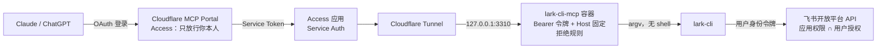

# 架构与设计思路

[English](architecture.md)

本文说明 lark-cli-mcp 为什么这样设计、请求怎么走、权限分几层、每层在哪里管。部署步骤见 [README](../README.zh-CN.md) 和 [cloudflare-mcp-portal.md](cloudflare-mcp-portal.md)。

## 1. 要解决的问题

- 想让 Claude、ChatGPT 这类 AI 助手直接在飞书里建文档、写多维表格、整理知识库。
- 客户端只连一个 MCP 入口，后面挂多个 MCP 服务器，以后加新服务不用每个客户端各配一遍。
- AI 助手可能被文档或网页里的内容误导（提示注入），所以**不能拿到服务器 shell**，能做的事也要有边界。

## 2. 考虑过的方案

| 方案 | 问题 |
| --- | --- |
| 飞书官方 `lark-openapi-mcp` | 2025 年后基本停更（v0.5.1，仍标 Beta）；按 API 一个工具，工具多、写云文档不方便。 |
| 飞书官方托管远程 MCP | 写作本文时仍在内测，只覆盖云文档；凭证有效期短，不适合挂在网关上长期用。 |
| 给 AI 开服务器账号，直接跑 `lark-cli` | AI 拿到 shell，等于能动整台服务器。 |
| 通用的「执行命令」MCP | 要么接近 shell，要么为了安全拒绝 `|`、`<`、`>` 等字符，Markdown 表格和标题写不进去。 |
| **本项目：只包 `lark-cli` 一个程序** | 飞书官方 CLI 覆盖面最全、更新最快；外面只加一层很薄的 MCP，没有 shell，只做拒绝规则。 |

## 3. 整体结构



- 服务器上没有对公网开放的端口：容器只监听本机回环，由 `cloudflared` 出站建立隧道。
- 客户端只认识 Portal 这一个地址；Portal 到后端用 service token，后端门禁只认这个 token。
- 换成别的反向代理也可以，只要保留「代理做身份认证 + 容器校验 Bearer 令牌」这两道。

## 4. 一次调用怎么走

1. AI 调用唯一的工具 `lark_cli(args, stdin)`，例如 `args = ["docs", "+create", "--doc-format", "markdown", "--content", "-"]`，正文放在 `stdin`。
2. 请求依次经过 Portal 登录、Access 门禁、隧道，到达容器。
3. 容器先校验 `Authorization: Bearer`（常量时间比较）和 Host，不对就返回 401 / 421。
4. 拒绝规则检查 `args`，命中就返回 `REFUSED: 原因`，根本不启动 `lark-cli`。
5. 通过的话，用 `subprocess.run([lark-cli, *args], input=stdin)` 执行，不经过 shell，`&&`、`$(...)` 都只是普通文字。
6. `lark-cli` 用登录时保存的令牌调用飞书 API，飞书按权限决定成不成功。
7. 返回 `exit=退出码` 加 stdout、stderr，超时和输出长度都有上限。

## 5. 权限分四层

| 层 | 管什么 | 在哪里改 |
| --- | --- | --- |
| 1. 入口 | 谁能连上 | Cloudflare：Portal 的 Access 策略（只放行你的邮箱）、后端 Access 应用（只认 service token）；容器：`MCP_BEARER_TOKEN`、`MCP_ALLOWED_HOSTS` |
| 2. 命令 | 能跑哪些 `lark-cli` 命令 | 容器 `.env` 里的 `LARK_CLI_*` 开关，见下一节 |
| 3. 飞书权限 | 能调哪些飞书接口 | 飞书开放平台 → 应用 → 权限管理；以及登录时 `auth login` 同意的范围 |
| 4. 数据范围 | 能碰到哪些文档、表格 | 登录的飞书账号本身能看能改的范围 |

最后实际能做的事，是四层都放行的交集。

### 第 2 层的两种用法

**默认（白名单）**：只放行 docs、drive、markdown、wiki、base、sheets、contact 和几个只读辅助命令；拒绝 `--yes` 高危写；原始 `api` 只许 GET。适合不想细调飞书权限的人。

**交给飞书管（作者的部署方式）**：

```
LARK_CLI_ALLOWED_DOMAINS=*
LARK_CLI_ALLOW_YES=1
LARK_CLI_ALLOW_API_WRITE=1
```

MCP 层放开，权限统一在飞书开放平台管。这样只有一个地方要维护，飞书后台改完就生效，不用动服务器。

两种用法下都**始终拒绝**下面三类，因为飞书开放平台管不到它们：

| 拒绝 | 原因 |
| --- | --- |
| `config`、`profile`、`update` | 能换应用、换凭证、替换程序本身，等于绕过飞书侧的全部设置。 |
| `auth login` / `logout`（`status`、`scopes`、`check`、`list` 可用） | 授权必须由运维者本人在浏览器里同意，AI 不能自己申请更多权限或换账号。 |
| `@文件` 参数 | `lark-cli` 会把 `@路径` 当成读本地文件，AI 可能借此把容器里保存的登录凭证读出来写进文档。正文一律走 stdin。 |

### 第 3 层：在飞书开放平台收紧

- 飞书的权限分得很细，删除是单独的权限项，例如 `space:document:delete`（删云文档）、`base:record:delete`、`base:table:delete`、`base:field:delete`。不想让 AI 删东西，就把这些「关闭」。
- `lark-cli` 的快捷命令按细分权限检查，例如删云空间文件需要 `space:document:delete`。
- 注意「管理全部」的大权限，例如 `drive:drive`、`docs:doc`、`bitable:app`：很多接口在权限列表里写的是「其中任一即可」，开了大权限，相应接口就能用。要靠细分权限控制，就别开这些大权限。
- 免审权限开通或关闭后立即生效，页面顶部会显示「当前修改均已发布」；需要审核的权限要在「版本管理与发布」里发布新版本、管理员审核通过后才生效。
- 用户身份下，实际权限 = 应用已开通的 ∩ 用户登录时同意的。`auth login` 不带参数会申请应用已开通的全部业务权限；可以用 `--domain` 缩小，或用 `--exclude <权限名>` 去掉某几项。
- 飞书后台「批量导入/导出权限」可直接粘贴的模板（含删除 / 不含删除）在 [feishu-scopes/](../feishu-scopes/)。
- 随时可以让 AI 调 `lark_cli(["auth","scopes"])` 查看当前实际拿到的权限。

### 第 4 层：用谁的身份

- 推荐用户身份（`--as user`）：建出来的文档归你本人，AI 能碰的范围和你自己一样，不会更多。
- 应用身份（`--as bot`）只能动应用自己建的、或被分享给应用的资源。
- 更稳妥的做法是给 AI 单独一个飞书账号，只把需要的文件夹分享给它。

## 6. 容器加固

- 非 root 用户（uid 10001），根文件系统只读，`/tmp` 是 32MB 的 noexec tmpfs。
- 去掉全部 Linux capabilities，开启 `no-new-privileges`。
- 限制内存 256MB、CPU 0.5 核、最多 128 个进程。
- `lark-cli` 从官方发布包下载，按写死的 SHA-256 校验；国内可走 npmmirror 镜像，校验不变。
- 唯一可写的位置是 `/data` 卷，里面是 `lark-cli` 的配置和登录令牌。

## 7. 秘密放在哪

| 秘密 | 位置 | 谁能看 |
| --- | --- | --- |
| MCP Bearer 令牌 | 服务器 `.env`（权限 600）；Portal 的自定义请求头 | 服务器 root、Cloudflare 管理员 |
| Service token | Cloudflare；Portal 的自定义请求头 | Cloudflare 管理员 |
| 飞书 App Secret、用户令牌 | 容器 `/data` 卷 | 服务器 root；AI 读不到（`@文件` 被拒绝，`config` 被拒绝） |

仓库里不放任何真实秘密，`.env` 已被 `.gitignore` 排除。

## 8. 紧急停用

任选其一，从快到彻底：

1. Portal 里取消勾选这个 MCP 服务器，所有客户端立刻看不到它。
2. 服务器上 `docker stop lark-cli-mcp`。
3. 飞书「授权管理」里取消对该应用的授权，已发出的用户令牌随之失效。
4. 吊销 Cloudflare 的 service token。

## 9. 部署和更新的分工

| 谁 | 做什么 |
| --- | --- |
| 运维者（人） | 跑安装脚本；`config init`、`auth login` 在浏览器里同意；在飞书开放平台开关权限；在 Cloudflare 配隧道、门禁、Portal |
| AI | 只通过 `lark_cli` 工具调用业务命令；可以查看 `auth status` / `auth scopes`，不能改授权和配置 |

更新：拉最新代码重新构建镜像、重建容器即可，`.env` 和 `/data` 卷保留，不用重新登录。

## 10. 不解决的问题

- 飞书账号本身被允许做的事，AI 都能做。权限要在第 3、4 层收紧。
- Bearer 令牌泄露后，只要代理层还在，外人仍过不了 Access；但应换令牌。
- `lark-cli` 自身的漏洞。
- 拒绝规则按参数判断，不理解每个命令的含义；细粒度控制以飞书权限为准。
